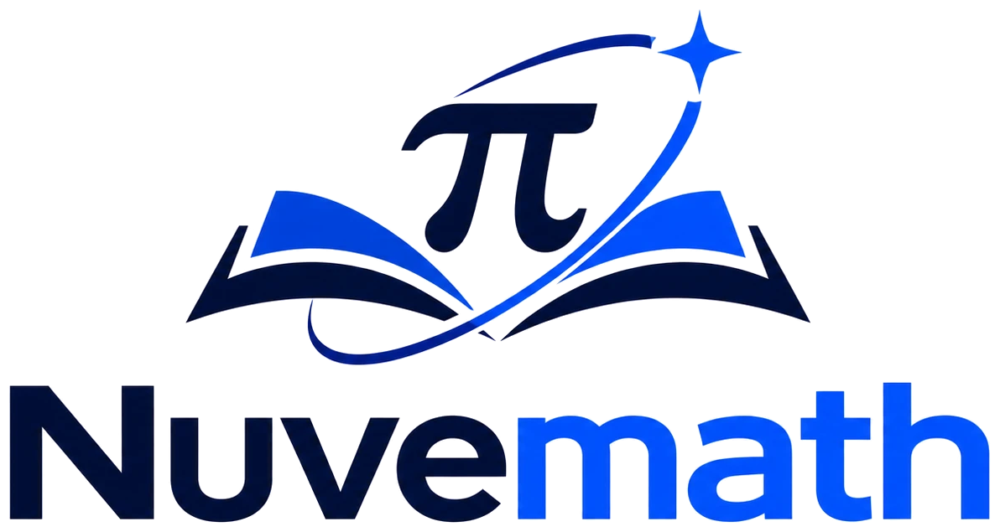

<p align="center"></p>

# Nuvemath — See Math. Explore Dimensions.

O‘zbek tilidagi (rus va ingliz tillari bilan) interaktiv matematika platformasi.
**Kolvo** (kimyo) va **Zenithra** (astronomiya) loyihalarining hamrohi — xuddi shu uslubda, statik sayt.

## Imkoniyatlar

- **Kirish animatsiyasi (intro, ~14 s)** — birinchi tashrifda: formulalar va 3D jismlar orbitada aylanadi, ko‘zoynakli odamcha ularni kuzatadi; π orbitadan ajralib uchadi, odamcha uni ushlaydi, so‘ng π logotipdagi joyiga uchib, logotip qismma-qism (π → kitob → orbita → yulduz) yig‘iladi va odamcha qo‘l silkitadi. Three.js + GSAP, «O‘tkazib yuborish» (yoki Esc), `prefers-reduced-motion` da yengil versiya. Qayta ko‘rish: «Introni qayta ko‘rish» yoki `?intro`.

- **Uch tilda** — butun ilova, jumladan darslik mazmuni, topshiriqlar va testlar o‘zbek, rus va ingliz tillarida.
- **Darslik** — sinf → qism → bo‘lim → mavzu tuzilmasida (1–11-sinf). Hozir tayyor: **1–3-sinflar, I–IV qismlar** (I.V. Repyova darsliklari asosida) va **4-sinf I qism** (V.Y. Uvarova va boshq., 2026), **5–6-sinf I–II qismlar**, **7-sinf** (Matematika 2026 I qism, Algebra va Geometriya 2022): 20 qism, 303 mavzu — sanoq va 100 gacha sonlar, masalalar, kattaliklar, perimetr, simmetriya, Rim raqamlari, tenglamalar (1-sinf); 1000 gacha sonlar, ustun usuli, uzunlik va vaqt, yuz, ko‘paytirish va bo‘lish jadvali, amallar tartibi, taqsimot xossasi, aylana (2-sinf); ko‘p xonali sonlar, burchakli bo‘lish, o‘lchov birliklari, hajm, ulushlar, sonli nur va koordinatalar, tezlik–vaqt–masofa, narx–qiymat, unumdorlik, to‘plamlar va Eyler-Venn diagrammalari (3-sinf); amallar tartibi, ikki va uch xonali songa ko‘paytirish va bo‘lish, bo‘linish alomatlari, million (4-sinf); oddiy va o‘nli kasrlar, uchburchak yuzi, hajm, nisbatlar, me’yor, foizlar, o‘rtacha qiymat, burchaklar, uchburchak va to‘rtburchak xossalari (5-sinf); algebraik ifodalar va tenglamalar, kasrlarni bo‘lish, foiz o‘zgarishi, doira va aylana (π), tezlik va harakat, kub qirrasi, doiraviy diagrammalar, jismlar yoyilmalari (6-sinf); tub sonlar, EKUB/EKUK, manfiy va haqiqiy sonlar, ko‘phadlar, qisqa ko‘paytirish formulalari, algebraik kasrlar, chiziqli funksiya grafigi, tenglamalar sistemasi, kombinatorika, parallel to‘g‘ri chiziqlar, uchburchaklar tengligi alomatlari, yasashlar (7-sinf). Har bir mavzuda 3D sahna, interaktiv topshiriqlar (3D sanash va teng guruhlar, o‘nlik tayoqcha va yuzlik plitalar, sxemalar, ustunda hisoblash, soat, katak qog‘ozda yuz, perimetr, tarozi, chizg‘ich va h.k.) va testlar; har bir bo‘lim va qism uchun yakuniy testlar. Topshiriqlar har safar yangi sonlar bilan yaratiladi.
- **Grafiklar** — istalgan funksiya grafigi: bir nechta funksiya, kattalashtirish/siljitish (sichqoncha va barmoq), koordinata ko‘rsatkichi, nollar, ekstremumlar va kesishish nuqtalari avtomatik topiladi (π/6 kabi aniq ko‘rinishda), hosila, `a` parametri slayderi.
- **Yechuvchi**
  - Tenglama: ko‘phadni standart ko‘rinishga keltirib, chiziqli va kvadrat tenglamalarni qadam-baqadam yechadi (diskriminant, aniq radikal javob `(3 ± √17)/4`, Viyet, tekshirish); yuqori darajali va transsendent tenglamalarni (sin, 2^x, ln, √, |x|) sonli usulda yechadi.
  - Sistema: 2–5 noma’lumli chiziqli sistemani Gauss usulida **kasrlar bilan** har bir qadamini ko‘rsatib yechadi; determinant, cheksiz/yechimsiz holatlar.
  - Kalkulyator: `sqrt(2)*sin(pi/4) + 3!` kabi ifodalar.
- **Chizma** — sudraladigan geometrik konstruksiyalar: uchburchak (mediana, balandlik, bissektrisa, tashqi/ichki aylana, Eyler chizig‘i, turi, yuzi, R, r), aylana (markaziy va ichki chizilgan burchak), to‘rtburchak (turini avtomatik aniqlaydi), koordinatalar (masofa, o‘rta nuqta, tenglama).
- **3D jismlar** — kub, parallelepiped, prizma, piramida, silindr, konus, kesik konus, shar: parametr slayderlari, hajm/sirt formulalari, karkas va **yoyilma** (SVG).
- **Mashq** — 14 mavzu × 3 daraja bo‘yicha cheksiz yangi masalalar, darhol tekshiruv, yordam, to‘liq yechim, ball va ketma-ketlik.
- Uch til (UZ/RU/EN), qorong‘i va yorug‘ rejim, telefonga moslashgan.

## Ishga tushirish

Hech qanday o‘rnatish shart emas — `index.html` ni brauzerda ochish kifoya (3D jismlar uchun internet kerak: Three.js CDN'dan yuklanadi).

Mahalliy server bilan (tavsiya etiladi):

```bash
npm start          # http://localhost:8080
npm test           # avtomatik testlar
```

## Tuzilma

| Fayl | Vazifasi |
|---|---|
| `index.html`, `css/style.css` | Sahifa va uslublar |
| `js/expr.js` | Xavfsiz matematik ifoda parseri (`eval` ishlatilmaydi): yashirin ko‘paytirish, funksiyalar, `|x|`, `5!`, `√`, `²` |
| `js/solver.js` | Kasrlar, ko‘phadlar, qadam-baqadam tenglama yechish, sonli ildiz qidirish, Gauss, determinant |
| `js/plotter.js` | Funksiya grafiklari va tahlil |
| `js/geometry.js` | Jonli 2D chizmalar |
| `js/solids.js` | 3D jismlar (Three.js) va yoyilmalar |
| `js/practice.js` | Masala generatori va javob tekshiruvi |
| `js/kids.js`, `css/kids.css` | Interaktiv dars dvigateli: 3D sahna, topshiriq turlari, testlar |
| `js/curriculum/index.js`, `helpers.js` | Sinf/qism tuzilmasi va umumiy masala yasovchilar; `g1-1.js` … `g7-3.js` — 1–3-sinf I–IV qismlar, 4-sinf I qism, 5–6-sinf I–II qismlar, 7-sinf 3 qism |
| `js/i18n.js` | Interfeys tarjimalari |
| `js/intro.js`, `css/intro.css` | Mustaqil intro komponenti (`NuvemathIntro.play({ force: true })`) |
| `assets/` | Logotip: asl rasm, shaffof emblema (yorug' va qorong'i fon uchun), favicon |
| `js/app.js` | Marshrutlash, sahifalar, progress (localStorage) |
| `test/run.js` | 26 ta avtomatik test (shu jumladan 16 800 ta tasodifiy masala tekshiruvi) |

GitHub Pages'ga joylash uchun: repozitoriyaga yuklang → Settings → Pages → `main` / root.
